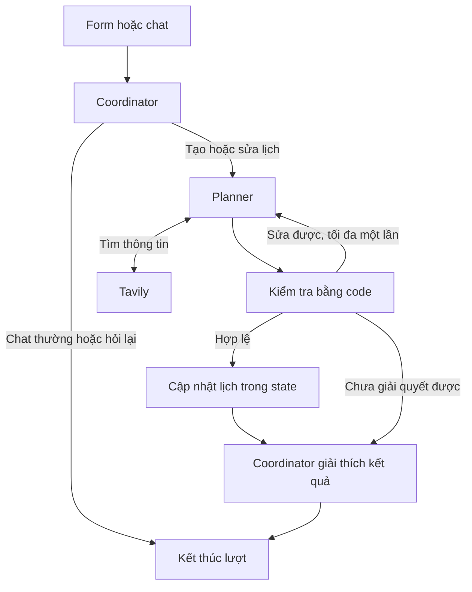

# Travel Planner — Kế hoạch triển khai tối thiểu

Ngày cập nhật: 2026-10-14
Trạng thái: Stack AI và model đã chốt; thiết kế triển khai chi tiết là đề xuất.

## Phạm vi bản đầu

Một trang web có ba phần: form địa điểm/ngày bắt đầu/số ngày, lịch trình hiện
tại và chat chỉnh sửa. AI tìm thông tin trên web, đề xuất lịch trình có nguồn,
rồi cập nhật lịch trình theo yêu cầu chat. State của app chỉ giữ trong phiên
hiện tại; trace hội thoại được gửi đến LangSmith.

Các chức năng cốt lõi:

- Tìm và gợi ý điểm tham quan.
- Xếp lịch theo ngày và giờ dự kiến.
- Sửa ngày giờ, đổi thứ tự, thêm, bỏ và thay điểm qua chat.
- Hiển thị nguồn, ước tính và thông tin chưa xác minh.
- Kiểm tra input, phạm vi ngày, trùng giờ và nguồn tham chiếu.

Tài khoản, lưu trữ lâu dài, chia sẻ chuyến đi, đặt vé/khách sạn, quản lý chi phí,
bản đồ tương tác và tối ưu tuyến đường không cần cho bản đầu này.

## Stack đã chốt và giao diện đề xuất

- Python + Streamlit cho giao diện một trang. Streamlit có sẵn form và các
  thành phần chat; đây vẫn là đề xuất giao diện.
- LangChain tích hợp hai agent, model, Tavily tool và output có cấu trúc.
- LangGraph quản lý state, nhánh chat/lập lịch, validation và giới hạn vòng sửa.
- Tavily thực hiện tìm kiếm và trả nội dung cùng URL nguồn.
- LangSmith trace từng lượt chat và toàn bộ các bước xử lý liên quan.
- Cả Coordinator và Planner dùng `gpt-5.5`, theo lựa chọn của người dùng.
- Code Python kiểm tra input, ngày giờ và nguồn tham chiếu.
- Session State giữ graph state của từng phiên: request, lịch trình, nguồn,
  hội thoại và mã phiên.

Streamlit Session State gắn với kết nối WebSocket; làm mới trang có thể làm mất
dữ liệu. Giao diện cần thông báo rõ điều này. Dữ liệu chuyến đi không được đặt
trong biến global hoặc cache dùng chung giữa các phiên.

Theo OpenAI Docs, `gpt-5.5` hỗ trợ function calling và structured outputs. Khả
năng truy cập model bằng API key/endpoint thực tế vẫn cần kiểm tra khi tích
hợp; không tự đổi model nếu tài khoản chưa truy cập được.

Chạy thật cần quyền gọi model, Tavily và LangSmith. Cấu hình mẫu nằm trong
`.env.example`. Kết quả giả lập chỉ phục vụ kiểm thử hoặc phát triển giao diện
và phải được ghi nhãn nếu hiển thị.

## Trách nhiệm của hai agent

| Agent | Đầu vào chính | Công việc | Đầu ra |
|---|---|---|---|
| Coordinator | Tin nhắn, request và lịch hiện tại | Chat thông thường; hỏi rõ; giao yêu cầu tạo/sửa cho Planner; giải thích kết quả | Phản hồi hoặc tác vụ có cấu trúc cho Planner |
| Planner | Request, tác vụ, lịch và nguồn hiện tại | Gọi Tavily khi cần; tạo lịch trình mới hoặc bản cập nhật | Lịch trình có cấu trúc, nguồn, điểm chưa rõ hoặc lỗi |

Coordinator giữ ngữ cảnh hội thoại. Planner nhận ngữ cảnh cần cho tác vụ hiện
tại, gồm lịch hiện tại khi chỉnh sửa. Planner không cần lịch sử riêng tồn tại
qua các phiên. Chỉ Planner đề xuất thay đổi lịch trình; code validation quyết
định bản mới có được áp dụng hay không.

Hai agent tăng số lần gọi model. Bản đầu dùng đúng hai agent và bàn giao tuần
tự, giới hạn một tác vụ lập/sửa lịch trình trong mỗi lượt người dùng. Các bước
kiểm tra và hiển thị dùng code để giữ phần điều phối gọn.

## Luồng xử lý

LangGraph custom workflow có các node thực thi agent và node code. Chat thường
đi thẳng từ Coordinator đến câu trả lời; yêu cầu tạo/sửa đi qua Planner.

Hai node Coordinator ở bước đầu và cuối dùng cùng vai trò agent. Bước trả lời
cuối chỉ diễn giải kết quả đã kiểm tra, không khởi động một lượt giao việc mới.

State tối thiểu gồm: `thread_id`, `turn_id`, `messages`, `trip_request`,
`current_plan`, `candidate_plan`, `sources`, `task`, `validation_errors` và
các bộ đếm giới hạn. Trong mỗi lượt, graph nhận state của phiên và trả state
mới; giao diện hiển thị `current_plan` từ state đó.

Một bản lịch trình có cấu trúc là dữ liệu chính để hiển thị và chỉnh sửa. Phản
hồi chat diễn giải thay đổi dựa trên bản lịch đó.

Khi sửa, Planner tạo bản dữ liệu lịch trình cập nhật từ lịch hiện tại và tác vụ
mới. Chỉ cập nhật lịch đang xem sau khi bản mới qua kiểm tra; lỗi không được
làm mất bản trước hoặc được báo như đã chỉnh thành công.

Nếu yêu cầu mơ hồ, hỏi lại. Nếu phát hiện xung đột, giải thích và đề xuất cách
sửa. Nếu tìm kiếm lỗi, nêu rõ thông tin chưa thể xác minh. Đề xuất giới hạn
ban đầu: tối đa ba lần tìm Tavily và một lần sửa kết quả trong mỗi lượt, tính
chung cả lần thử sửa. Có thêm giới hạn số bước của graph để bảo đảm kết thúc.

Planner tìm thêm khi tạo lịch, thêm/thay điểm hoặc khi thông tin hiện tại không
đủ cho việc sửa. Chỉnh giờ hoặc bỏ điểm có thể tái sử dụng nguồn hiện tại nếu
phù hợp. Tavily search trả nguồn để Planner tổng hợp; kết quả tìm kiếm vẫn cần
được đánh giá về mức liên quan và không tự xác nhận mọi thông tin là đúng.

## Trace theo phiên trên LangSmith

- Tạo một `thread_id` ngẫu nhiên khi mở phiên và một `turn_id` cho mỗi lượt.
- Mỗi lượt tạo/sửa hoặc chat thường có một root trace; truyền `thread_id` qua
  metadata của tất cả runs, kể cả child runs của agent, model và Tavily.
- Trace ghi đường đi qua graph, bàn giao tác vụ, tool calls, validation, lỗi,
  thời gian xử lý và thông tin token nếu provider trả về.
- Lịch sử chat hoạt động lấy từ state trong phiên. LangSmith dùng để quan sát;
  app không đọc trace để khôi phục hội thoại.
- Trace có thể tồn tại trên LangSmith sau khi app mất phiên, theo cấu hình lưu
  giữ của dịch vụ. Giao diện ghi rõ hội thoại được trace bằng LangSmith.
- Cấu hình dùng `LANGSMITH_TRACING`, `LANGSMITH_API_KEY`, `LANGSMITH_PROJECT`;
  endpoint/workspace được khai báo khi môi trường yêu cầu.
- API keys không được đưa vào prompt, metadata hoặc nội dung log.

## Ba bước triển khai

### 1. Tạo lịch trình từ tìm kiếm thật

Định nghĩa dữ liệu request, điểm tham quan, nguồn và mục lịch trình. Tạo hai
agent LangChain dùng `gpt-5.5`, graph LangGraph và Tavily tool. Gắn trace từ đầu.
Hoàn tất khi chat thường được Coordinator xử lý và yêu cầu tạo lịch được giao
cho Planner, tạo được lịch trình có nguồn từ lượt tìm kiếm thật.

### 2. Chỉnh sửa lịch trình qua chat

Dùng lại dữ liệu và luồng xử lý của bước 1. Hỗ trợ đổi giờ/ngày, đổi thứ tự,
thêm, bỏ và thay điểm. Hoàn tất khi mỗi thao tác cập nhật đúng lịch trình và
nguồn liên quan, hoặc trả câu hỏi/cảnh báo rõ ràng nếu chưa thực hiện được.

### 3. Hoàn thiện webapp và kiểm chứng

Gắn form, lịch trình và chat vào một trang; giữ dữ liệu theo phiên. Kiểm chứng
các tình huống trong `docs/project-charter.md`, gồm routing giữa hai agent, lỗi tìm kiếm,
sửa lịch gây xung đột và cách ly dữ liệu giữa các phiên. Kiểm thử tự động dùng
phản hồi provider giả lập; chạy thử tích hợp thật riêng và kiểm tra các lượt
chat được nhóm đúng phiên trên LangSmith. Hoàn tất khi app chạy end-to-end,
trace thật xem được và kết quả kiểm chứng được ghi lại.

## Giới hạn cần thể hiện trên giao diện

Kiểm tra bằng code giúp phát hiện trùng giờ, sai ngày và nguồn không khớp dữ
liệu tìm kiếm. Độ đúng của giờ mở cửa vẫn phụ thuộc nguồn tìm được. Thời gian
di chuyển là ước tính khi chưa có dữ liệu tuyến đường; không được trình bày
như thời gian đo từ bản đồ.

## Tài liệu kỹ thuật đã đối chiếu

- [Streamlit forms](https://docs.streamlit.io/develop/api-reference/execution-flow/st.form)
- [Streamlit chat elements](https://docs.streamlit.io/develop/api-reference/chat)
- [Streamlit Session State](https://docs.streamlit.io/develop/api-reference/caching-and-state/st.session_state)
- [LangChain subagents](https://docs.langchain.com/oss/python/langchain/multi-agent/subagents)
- [LangGraph overview](https://docs.langchain.com/oss/python/langgraph/overview)
- [LangSmith tracing](https://docs.langchain.com/langsmith/trace-with-langchain)
- [LangSmith threads](https://docs.langchain.com/langsmith/threads)
- [Tavily Search API](https://docs.tavily.com/documentation/api-reference/endpoint/search)
- [OpenAI Docs: GPT-5.5](https://developers.openai.com/api/docs/models/gpt-5.5)
